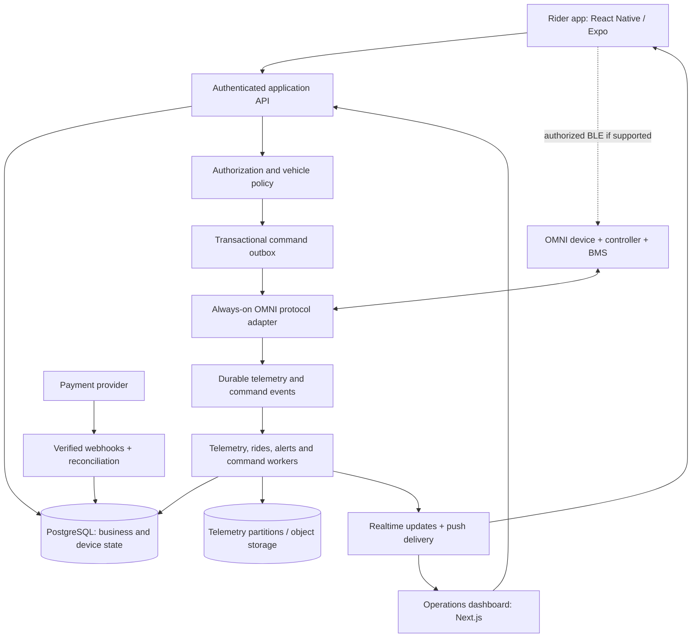

# DandoEv connected e-bike implementation plan

Date: 26 October 2026. Status: proposed architecture; hardware feasibility must be validated before committing to delivery.

## 1. Product and scope

Build one rider app for outright and BNPL buyers, supported by an operations dashboard and connected-bike backend. Reuse the existing commerce, identity, payments, and financing platform after auditing its production readiness. Separate purchase type, loan status, device connectivity, and vehicle security state: these are different concepts and must not share a single status field.

Outright buyers receive ride, maintenance, navigation, security, firmware, weather, and community features. BNPL buyers receive those features plus repayment schedules, receipts, reminders, arrears notices, dispute handling, and account restriction status. Community and advanced analytics follow the connected-bike MVP.

No financing restriction applies to an outright purchase. Loan completion permanently removes finance authority for that agreement; an unrelated subscription lapse must not disable the bike. Security and service restrictions require separately authorized purposes.

## 2. Evidence and vendor discovery gate

The [OMNI Electric Bike System page](https://www.omnismartiot.com/Solution/Electric-Bike-System/) describes connected components, Bluetooth/4G connectivity, app features, remote management, and firmware updates. It is a product overview, not an implementable protocol specification. It links to an [OMNI developer platform](https://developer.omnibike.net/), whose technical content was not available in the public text retrieved during this review. No message format, transport, command code, or security guarantee is confirmed by this plan.

Request the following directly from OMNI before implementation:

- Exact IoT, display, controller, motor, BMS, lock, and firmware models; compatibility matrix and regional cellular support.
- Versioned cellular protocol and/or vendor cloud API, BLE SDK/GATT documentation, sample messages, sandbox credentials, and test devices.
- Device provisioning, endpoint configuration, SIM/APN setup, identity, credentials, encryption, key rotation, reconnect, heartbeat, and roaming behaviour.
- Telemetry units, timestamps, sequence numbers, accuracy, error codes, supported sampling intervals, offline buffering, and battery-data availability.
- Lock/unlock, alarm, assistance, and firmware command semantics; acknowledgements, execution feedback, expiry, retries, and ordering guarantees.
- Whether an administrative inhibit persists across power removal, reset, Bluetooth unlock, physical key, display buttons, controller replacement, and firmware updates.
- Device-side stationary detection and next-start inhibition; absence of GPS or connectivity must not trigger an unsafe action.
- Firmware signing ownership, anti-rollback, recovery/rollback support, bootloader controls, and compatible OTA paths for each component.
- Vendor-cloud commercial terms, rate limits, availability, data residency, exportability, ownership, and exit arrangements.

Use 3–5 complete bikes for bench and controlled field tests. A tracker alone does not establish motor/BMS/lock integration. If the selected hardware cannot enforce persistent restrictions safely, choose compatible hardware or revise the business requirement before financed deployment.

## 3. System topology

The gateway uses the documented OMNI transport; do not assume MQTT, TCP, or HTTP. If OMNI requires its cloud, the adapter connects through its approved API/webhooks instead of directly to devices. Keep a stable internal interface so vendor-specific formats do not spread into business logic.

Begin with a modular application backend and separately deployed long-running gateway/workers. Existing repository manifests show Next.js, React Native/Expo, Prisma/PostgreSQL, Redis/BullMQ, and monitoring dependencies. Their presence is not proof that production infrastructure is configured. The older architecture document describes an earlier baseline and should not be treated as a current audit.

Run persistent device connections outside short-lived web request handlers. Use PostgreSQL for authoritative state, a transactional outbox for reliable dispatch, Redis/BullMQ for jobs and transient state, and object storage for firmware and archived telemetry. Add time-series specialization only when measured volume justifies it. Treat queues as at-least-once delivery and make consumers idempotent.

## 4. Feature implementation

| Capability | Rider experience | Backend and hardware work |
|---|---|---|
| Activation | Claim bike at delivery; view serial and warranty | Staff-authorized ownership assignment, device binding, credential provisioning; QR possession alone is insufficient |
| Live ride | Speed, distance, battery, connectivity, last update | Normalize device telemetry; distinguish actual BMS values from estimates; local BLE where supported |
| Maintenance | Fault and service alerts; booking/history | Fault codes, mileage/time thresholds, alert deduplication, service tickets; predictive maintenance later |
| Ride history | Route, distance, duration, average speed | Ride segmentation, GPS quality filtering, offline backfill, odometer reconciliation, gaps and confidence labels |
| Navigation | Cycling routes, waypoints, spoken turns | Evaluate map coverage and navigation SDK on launch roads; phone navigation can work independently of tracker data |
| Assistance | Supported modes and current setting | Capability-based controls within manufacturer limits; device safety checks and confirmed applied mode |
| Anti-theft | Owner lock, movement/tamper alarms, location | Authorized commands, alarm events, last-known GPS accuracy and time; no promise of theft prevention |
| Firmware | Update eligibility, progress and result | Signed compatible packages, safe-state checks, canary rollout, recovery and post-update verification |
| Community | Opt-in ride sharing and challenges | Moderation, reporting, anti-cheat checks, hide route endpoints; never expose live private locations by default |
| Weather | Forecast along planned ride | Licensed forecast integration, caching, attribution and freshness; unavailable forecasts do not block riding |
| BNPL | Repayment plan, receipts, notices and disputes | Verified payment events, ledger, reconciliations, grace rules, policy holds and finance release |

Define average speed as moving or elapsed speed explicitly. Use a validated odometer where available; GPS-derived distance is an estimate. Range and battery health must be labelled as estimates unless supported by measured hardware data.

## 5. Administrative restrictions and safety

An admin restriction is an independent inhibit reason, not a rider-lock flag. Store each active hold separately: finance, theft, service/safety, and rider lock. Starting is allowed only when all relevant inhibits are cleared. Clearing one must never clear another.

Proposed finance progression:

`current → overdue → grace period → reviewed restriction → pending device application → applied → reviewed release`

Payment, dispute, hardship, or reconciliation events can stop or reverse a pending restriction. Exact grace periods, notices, recovery procedures, privacy permissions, and exception rules require approved market-specific operating policies before launch; this plan does not establish legal entitlement to immobilize or retrieve property.

Enforcement requirements:

1. The backend checks role, asset ownership, active contract, ledger status, notices, holds, and reason before creating a command. A missed webhook alone is never proof of default.
2. Use separate requester and approver roles for finance restriction and recovery, with MFA, reason codes and an append-only audit trail. Emergency releases are controlled and audited.
3. Inhibit the next safe start. Never engage a wheel lock or abruptly cut propulsion while moving. Device-side safeguards are mandatory; a stale server speed of zero is insufficient.
4. While finance restriction is active, rider API and BLE credentials cannot authorize release. Firmware must enforce the same policy across all supported entry points. App-only restrictions cannot satisfy this requirement.
5. Cloud unreachability cannot be shown as a successful lock. Show requested, pending, applied, failed, expired, or unknown, alongside last contact and reported hardware state.
6. Persist the most recent applicable policy on the device if supported. Reject expired/replayed commands using device-supported sequencing or policy versions. Cancel superseded pending work before dispatch.
7. A verified payment changes the ledger and triggers policy reevaluation. Finance clearance does not clear theft/service holds or an owner's lock. Loan settlement also revokes the agreement's future finance-control entitlement.
8. Offline restrictions cannot be delivered until communication returns. Do not introduce automatic offline lease expiry for finance enforcement without a separate safety and business review.

There is no absolute guarantee against physical tampering or controller replacement. Document this residual risk and detect tamper events where hardware allows it.

## 6. Core data and event contracts

Add physical `Vehicle` records distinct from catalog bike models. Associate vehicles with orders, ownership history, optional finance agreements, devices, batteries, and controller identities.

Core records: Vehicle, Device, DeviceCapability, DeviceCredentialReference, OwnershipAssignment, Battery, TelemetryEvent, LatestDeviceState, Ride, RidePoint, FaultEvent, MaintenanceTicket, PolicyHold, DeviceCommand, CommandAttempt, CommandAcknowledgement, FirmwareArtifact, FirmwareCampaign, FirmwareInstallation, RecoveryCase, ConsentRecord, LocationAccessAudit, and AuditEvent. Reuse existing Loan, Repayment and PaymentTransaction models after audit; add ledger/journal records if the current payment accounting lacks them.

Telemetry includes device and vehicle IDs, protocol/schema version, observed and received timestamps, sequence/event identity, source, units, GPS accuracy, and quality flags. Retain limited raw payloads for diagnosis with redaction. Late telemetry may repair history but must not overwrite newer current state.

Commands include command ID, actor, reason, target, desired policy version, expiry, idempotency key, and lifecycle timestamps. Track created, approved, queued, sent, acknowledged, applied, failed, expired, cancelled and unknown separately. Transport acknowledgement is not physical execution. If OMNI lacks execution feedback, expose that limitation and verify via subsequent reported state where possible.

Recheck current authorization immediately before dispatch. Serialize conflicting commands per device, use bounded retries only for safe operations, and reconcile desired versus reported state. Never replay an obsolete lock after a newer release. Some guarantees require firmware/vendor support and must be part of the feasibility gate.

## 7. Dashboard and operational access

- Operations: fleet map, connectivity, GPS freshness, faults, battery condition, command outcomes, servicing and device replacement.
- Finance: loan health, arrears, payments, disputes, restriction proposals and release workflow.
- Recovery: assigned cases, approved vehicle details, time-limited location access, retrieval records and case closure.
- Support: identity-checked troubleshooting and escalations with scoped permissions.
- Security administrators: provisioning, credentials, access reviews and audit investigation; no routine unrestricted location browsing.

Default reporting uses aggregates. Access to precise location must be scoped to purpose, role, asset and time. Record who accessed location and why. No public map of overdue customers.

## 8. Security, firmware and resilience

Use per-device identity and keys where supported, protected secret storage, encrypted transport, credential revocation, replay protection and command rate limits. If the vendor protocol has gaps, require a documented mitigation or hardware change; a private APN alone is not end-to-end authentication.

Enforce resource-level authorization on every API and realtime subscription. Keep device credentials out of the mobile application. BLE access, if available, needs short-lived scoped authorization, secure pairing, replay resistance and persistent device-side admin policy. Recovery from lost phones or replacement devices must revoke old access.

Firmware rollout: vendor-approved signed artifact → compatible hardware cohort → internal test → small canary → phased deployment → health monitoring. Require parked state, adequate battery and manufacturer-specific conditions; suspend new starts during unsafe update phases. Resume interrupted transfers, verify installed versions, and use bootloader-supported rollback/recovery. Mobile application updates and bike firmware updates are separate release processes.

Configure database backups with point-in-time recovery, restore drills, gateway reconnect handling, dead-letter queues, payment reconciliation, and operator runbooks. Monitor device freshness, ingest lag, command latency/failures, payment mismatches, OTA failures and authorization anomalies.

Proposed pilot retention: detailed ride points for 90 days and longer-lived ride summaries, subject to customer needs and approved retention policy. Financial and recovery records have independently reviewed retention. Support export, account deletion and ownership transfer without deleting records that must legitimately be retained.

## 9. Capacity, service targets and costs

Sizing example, not a vendor promise: 1,000 bikes reporting every 10 seconds for 2 riding hours generate 720,000 riding messages/day. Five-minute parked reporting for the other 22 hours adds 264,000 messages/day. At 1 KB per event, the total is about 0.98 GB/day before indexes, replication, and overhead. Continuous 10-second reporting would be 8.64 million events/day instead. Validate battery and SIM impact before choosing cadence.

Pilot targets: 95% of received live telemetry visible within 5 seconds of backend receipt; 95% of commands to already connected healthy devices confirmed within 15 seconds, subject to hardware validation; 99.9% monthly application API availability; database recovery point within 15 minutes and recovery within 4 hours. These are engineering objectives, not commitments until measured. Offline devices are reported separately, never silently excluded from fleet health.

Budget separately for hardware and installation, SIM/data per bike, vendor licensing, cloud compute/storage, maps/navigation, weather, messages, payment fees, app distribution, support and field servicing. Obtain quotes using fleet count and measured usage; no defensible fixed price is possible from the product overview alone.

## 10. Delivery roadmap

Indicative 20–26 week programme with overlapping streams, assuming timely vendor access and compatible hardware. Procurement, firmware changes and regulatory review can extend it.

| Stage | Indicative duration | Deliverables and exit gate |
|---|---|---|
| Discovery and hardware proof | 2–3 weeks | Protocol pack, device matrix, security review; prove telemetry, safe inhibit and persistent admin authority on complete bikes |
| Platform foundation | 3–4 weeks | Identity/ownership model, gateway, provisioning, event contracts, telemetry storage and observability |
| Connected rider MVP | 4–6 weeks | Live dashboard, ride history, owner security, maintenance, basic weather and navigation; native device tests |
| BNPL and operations | 3–4 weeks | Ledger integration, notices, approvals, restrictions/releases, dashboard and recovery workflow |
| Field pilot and hardening | 4–6 weeks | 25–50 consenting bikes across outright and financed cohorts; connectivity, battery, safety, payments, OTA and restore testing |
| Expanded experience | 4–6 weeks, partly overlapping | Wider navigation/offline coverage, community, challenges, deeper analytics and controlled production rollout |

Suggested team: technical lead/architect, two backend/IoT engineers, one or two mobile engineers, one web engineer, QA engineer, and shared product/design, DevOps/security, hardware and operations specialists. This is a staffing estimate, not a validated delivery commitment.

## 11. Release acceptance

- Unauthorized users cannot read another bike's telemetry or send commands, including through realtime and BLE paths.
- Finance restrictions cannot be bypassed by supported rider controls, reinstall, reboot, power cycle, expired credential replay, or old commands.
- No restriction immobilizes a moving bike; stationary GPS spoofing/staleness and lost connectivity cannot bypass local safety checks.
- Duplicate and out-of-order telemetry, webhooks and commands do not corrupt history, double-credit payments, or reapply superseded holds.
- Payment/restriction races, partial payments, reversals, disputes and manual release scenarios produce the approved policy outcome.
- Outright and settled agreements cannot acquire an unauthorized finance hold.
- Interrupted firmware updates recover on supported hardware and report actual installed version.
- SIM loss, tunnels, dead phone battery, GPS loss, device replacement, low battery and tamper attempts have tested outcomes.
- Pilot demonstrates measured telemetry accuracy, command outcomes, operating cost and restore targets before fleet expansion.

Immediate next step: secure OMNI's exact hardware/protocol package and run the hardware proof while auditing the existing app and payment flow. Detailed API contracts, schema migrations and sprint estimates follow that evidence.
